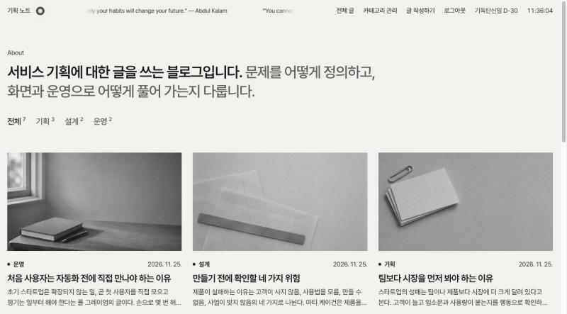
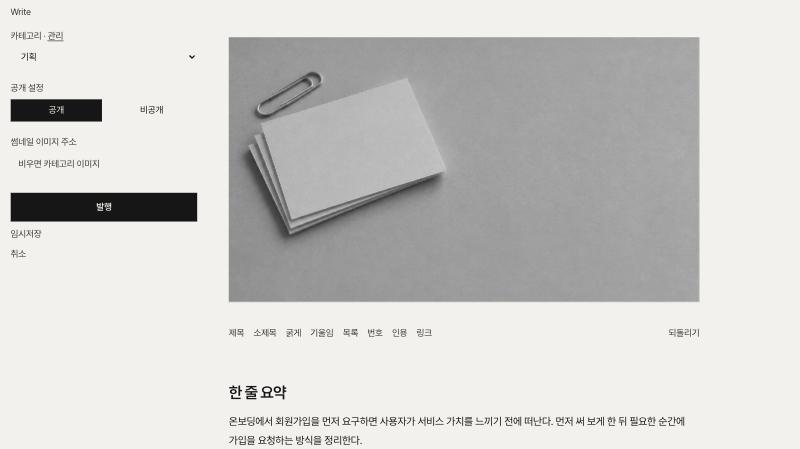
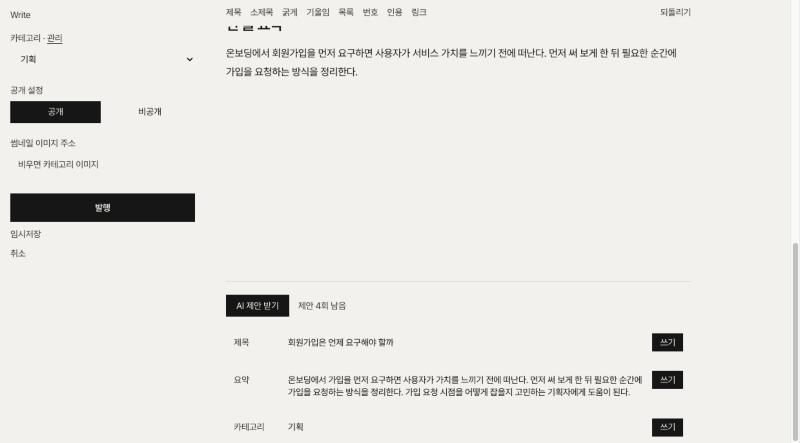
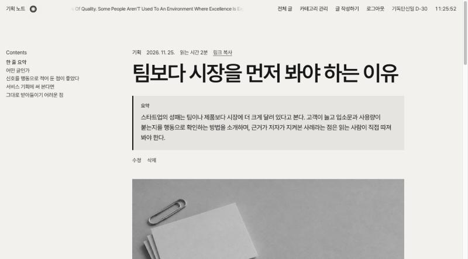

# 테스트 보고서

> 목적: AI 워크플로우(발행 보조와 독자용 요약)가 PRD의 목표(KR1~KR4)를 얻었는지, 기능이 요구한 대로 동작하는지를 단위 테스트, 전체 유저플로우, 지표 측정으로 확인한 결과와 한계를 남긴다.

테스트는 2026-11-25에 배포된 사이트(https://jicongjy.github.io/blog/)와 단위 테스트(`npm test`)로 했다. 결과는 사실만 적었고, 확인하지 못한 것은 "확인 못 함"으로 적었다.

## 1. 결과 요약

| 목표 | 합격 기준 | 결과 | 판정 |
|---|---|---|---|
| KR1 공개 글 | 0편에서 3편 이상 | 실제 글 3편을 공개로 발행(11:19~11:21). 예시 글 4개는 비공개로 바꿈 | 달성 (아래 한계 1) |
| KR2 올리는 시간 | 구현 전 77.8초보다 30% 짧게(54.5초 이하) | 첫 시도 17.6초(77% 단축), 셋째 시도 32.5초(58% 단축) | 달성 |
| KR3 제안 반영 | 제안의 절반 이상을 그대로 또는 고쳐서 사용 | 글에 남은 기록 9항목 중 8개 그대로, 1개 고침. 제안 요청 7번 중 3번의 결과를 사용 | 기록 기준 달성, 요청 기준 43% (아래 한계 2) |
| KR4 요약 정확도 | 본문과 맞지 않는 요약 0건 | 요약 3건 모두 본문과 맞음. 쓰지 않은 제목 제안 1건은 본문과 어긋남 | 달성 |
| 성공률과 응답 시간 | 성공률 90% 이상, 응답 10초 이내 | 관찰한 호출 모두 성공, 응답 1.2~1.7초 | 달성 (아래 한계 3) |
| 독자 화면의 AI 호출 | 0회 | 단위 테스트 3개로 확인(독자 화면은 AI 모듈을 읽지 않음) | 달성 |

## 2. 테스트 방법

1. 단위 테스트 46개(vitest). 기능별 결과는 4장.
2. 전체 유저플로우: 배포된 사이트에서 관리자 로그인, 본문 작성, AI 제안, 쓰기와 고쳐 쓰기, 발행 점검, 발행, 독자 화면 확인.
3. 지표 측정: 올리는 시간은 페이지 타이머([구현 전](research/baseline-publish-time.md), [구현 후](research/after-publish-time.md)), 제안 반영은 글에 저장된 사용 기록, 요약 정확도는 본문과 직접 대조.

## 3. 전체 유저플로우

| 단계 | 한 일 | 결과 | 화면 |
|---|---|---|---|
| 1 | 방문자가 홈을 연다 | 소개 문구와 글 카드가 3열로 나오고 "글 작성하기" 메뉴는 로그인한 관리자에게만 보인다 |  |
| 2 | 관리자가 글쓰기를 연다 | 로그인 전에는 "로그인이 필요합니다"가 나오고, 로그인하면 에디터가 열린다 |  |
| 3 | 본문을 쓰고 "AI 제안 받기"를 누른다 | 1.2초 안팎에 제목, 요약, 카테고리 제안이 한 개씩 나오고 "제안 4회 남음"이 보인다. 제안은 입력칸을 덮어쓰지 않는다 |  |
| 4 | 항목마다 "쓰기"를 누르거나 직접 고친다 | 누른 항목만 입력칸에 들어간다 | 3번 화면의 쓰기 버튼 |
| 5 | 제목과 요약을 비우고 "발행"을 누른다 | "발행하려면 다음을 채워 주세요: 제목, 요약" 경고가 뜨고 발행되지 않는다. 내장 브라우저는 경고창을 캡처하지 못해 콘솔 기록으로 확인했다 | 콘솔 기록 |
| 6 | 표지를 비운 채 발행한다 | "표지 이미지가 비어 있어 이대로 발행할까요?" 확인을 거쳐 발행된다(표지는 알리기만 한다) | 화면 캡처 없음 |
| 7 | 독자가 글을 연다 | 글 맨 위에 요약 상자가 보이고 목록 카드에도 요약이 나온다 |  |

## 4. 기능별 단위 테스트

실행: `npm test`. 결과: 7개 파일, 46개 모두 통과.

| 기능 | 확인한 것 | 테스트 파일 | 개수 |
|---|---|---|---|
| F1 AI 제안 | 프롬프트에 제목, 본문, 카테고리와 규칙이 들어감, 제안값 정리, 목록에 없는 카테고리는 비움, 성공하면 제안과 응답 시간을 돌려줌 | `src/lib/suggest.test.js` | 16 (F6 포함) |
| F2 발행 전 점검 | 제목, 요약, 카테고리가 비면 막고 표지는 알리기만 함 | `src/lib/publishCheck.test.js` | 4 |
| F3 독자 화면에 AI 없음 | 독자 화면이 AI 모듈을 읽지 않음 | `src/readerNoAi.test.js` | 3 |
| F4 요약 표시 | 단위 테스트 없음. 화면으로 확인(3장 7번) | 없음 | 0 |
| F5 관리자만 AI 버튼 | 관리자 확인, 키는 관리자일 때만 읽고 로그아웃하면 버림, 상단 메뉴의 글 작성하기 노출 조건 | `src/lib/ai.test.js`, `src/components/HmTop.test.jsx` | 8 + 2 |
| F6 실패 처리 | 서비스 불가, 네트워크 오류, 시간 초과일 때 예외를 던져 화면이 직접 입력으로 이어지게 함 | `src/lib/suggest.test.js`에 포함 | 위에 포함 |
| F7 사용 기록 | 호출 횟수, 마지막 결과, 제안값과 최종값 저장, 글을 다시 열면 이어받기 | `src/lib/aiUsage.test.js` | 6 |
| 본문 변환 | 붙여 넣은 마크다운 기호를 제목과 목록으로 바꿈(번호 한두 자리만) | `src/lib/body.test.js` | 7 |

단위 테스트는 AI가 낸 제안의 품질(제목이 자연스러운지, 요약이 정확한지)을 검증하지 못한다. 그 부분은 5장의 직접 확인으로 다뤘다.

## 5. 지표 결과

### 5.1 올리는 시간 (KR2)

| 시도 | 걸린 시간 | 구현 전 77.8초 대비 | AI 호출 | 제안 사용 |
|---|---|---|---|---|
| 첫 시도 | 17.6초 | 77% 단축 | 1회 | 세 항목 모두 제안 그대로 |
| 둘째 시도 | 중단 | 해당 없음 | 5회 | 쓸 만한 제목이 없어 발행하지 않음 |
| 셋째 시도 | 32.5초 | 58% 단축 | 5회 | 카테고리는 그대로, 제목과 요약은 고쳐 씀 |

자세한 방법과 한계는 [구현 후 측정값](research/after-publish-time.md).

### 5.2 AI 제안 사용 기록 (KR3, 응답 시간)

글에 저장된 기록(마지막 제안값과 최종값)이다.

| 글 | 요청 횟수 | 제목 | 요약 | 카테고리 | 마지막 응답 |
|---|---|---|---|---|---|
| 팀보다 시장을 먼저 봐야 하는 이유 | 3 | 그대로 | 그대로 | 그대로 | 1.2초 |
| 만들기 전에 확인할 네 가지 위험 | 2 | 그대로 | 그대로 | 고침(기획에서 설계로) | 1.2초 |
| 처음 사용자는 자동화 전에 직접 만나야 하는 이유 | 2 | 그대로 | 그대로 | 그대로 | 1.3초 |

- 9개 항목 중 그대로 8, 고침 1, 버림 0.
- 글에 남는 기록은 마지막 제안뿐이다. 중간에 받고 쓰지 않은 제안 4번은 기록에 없고 이 보고서의 수치에는 직접 세어 더했다. 요청 7번 중 3번의 결과를 썼다(43%).

### 5.3 요약 정확도 (KR4)

| 글 | 판정 | 비고 |
|---|---|---|
| 팀보다 시장을 먼저 봐야 하는 이유 | 정확 | 120자, 두 문장 |
| 만들기 전에 확인할 네 가지 위험 | 정확 | 145자, 세 문장. 내용은 맞지만 "120자 안팎, 두 문장 이하" 지시를 지키지 않음 |
| 처음 사용자는 자동화 전에 직접 만나야 하는 이유 | 정확 | 둘째 문장의 "~고 말한다"가 저자의 주장과 글쓴이의 해석을 함께 가리켜 읽힐 수 있음 |

요약 외에 제목 제안 한 건(시장이 중요하다는 글에 "서비스가 살아남으려면 사람보다 고객이 먼저다")이 본문과 어긋나서 쓰지 않았다.

## 6. 실패와 한계

실패와 조치는 [성공과 실패 로그](success-failure-log.md)에 따로 적었다. 이 보고서의 결과를 읽을 때 알아야 할 한계는 다음과 같다.

1. **글을 쓰고 발행한 주체**: 공개 글 3편의 본문 작성, 제안 선택, 발행은 홍지영의 요청으로 Claude가 했다. 원문(안드리슨, 케이건, 그레이엄)은 직접 읽고 확인했고 출처 링크를 달았다. KR1은 숫자로 달성했지만 블로그 운영자가 직접 쓴 글은 아니다.
2. **KR3의 의미**: 반영률은 제안을 고른 사람(Claude)의 선택이 반영된 값이라, 운영자가 직접 쓸 때의 값과 다를 수 있다. 요청 기준 43%를 함께 적은 이유다.
3. **성공률**: 글에는 마지막 호출의 성공 여부만 남는다. 관찰한 호출 중 실패는 없었지만 전체 호출의 성공률은 기록으로 계산하지 못했다.
4. **측정 횟수와 환경**: 올리는 시간은 구현 전 1회, 구현 후 2회다. 구현 전은 로컬 미리보기, 구현 후는 실제 에디터이고, 같은 시험 본문을 반복해 읽었다.
5. **프롬프트 버전**: 올리는 시간 두 값은 겹문장 금지 규칙을 넣기 전의 프롬프트로 쟀다. 현재 코드의 프롬프트로 다시 재지 않았다.
6. **독자 쪽 효과**: 방문 데이터가 적고 GA4 보고서 반영이 늦어 요약이 독자에게 미친 효과는 이번 기간에 판정하지 못했다.
7. **보안**: AI 키가 관리자 브라우저로 내려오는 구조다. 위험은 Anthropic 콘솔의 월 사용 한도와 글당 제안 5회로 줄이는데, 월 한도 금액이 걸려 있는지는 확인하지 못했다.
8. **새 글 주소의 응답 상태**: 방금 발행한 글의 주소를 직접 열면 페이지는 보이지만 응답 상태가 404로 나왔다. 글별 공유 페이지는 정기 배포(20분마다)에서 만들어지기 때문으로 보이며 원인은 확인하지 못했다.
